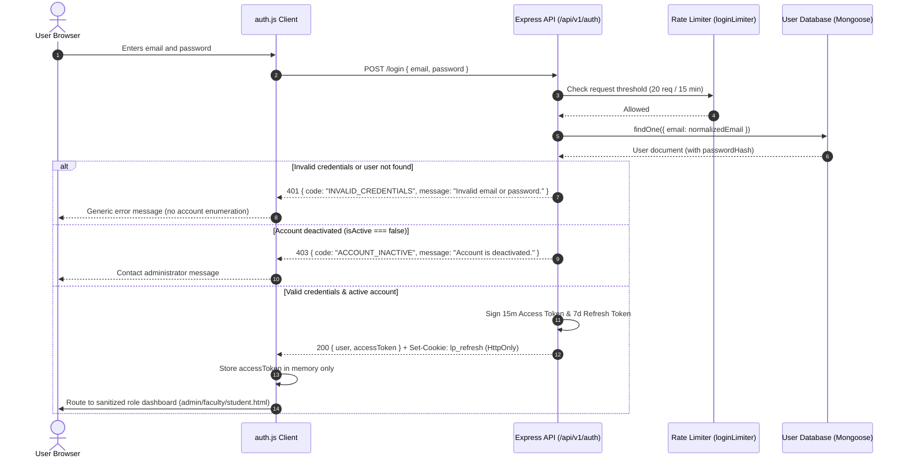
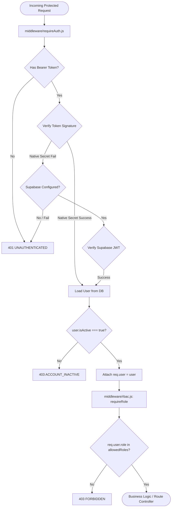

# MODULE 04: LabPulse Authentication, Identity & Role-Based Access Control Architecture Record

## Executive Summary

This architecture document defines the production authentication, identity management, and role-based access control (RBAC) foundation for the LabPulse laboratory management SaaS. It details the operational identity model across the three core institutional personas (**ADMIN**, **FACULTY**, **STUDENT**), establishes cryptographic guarantees, formalizes session handling and token rotation, specifies open-redirect and privilege-escalation mitigations, and sets the migration bridge toward Supabase Auth without prematurely introducing Module 05 (PostgreSQL schema migration) or Module 06 (Mongoose replacement).

---

## 1. Current Identity Architecture

The active identity layer in LabPulse enforces server-authoritative authentication and authorization built on verified cryptographic standards:

### 1.1 Password Management & Hashing
- **Algorithm**: Bcrypt with salt rounds = 12 (`bcryptjs`).
- **Policy Enforcement**: `utils/password.js` requires passwords between 8 and 128 characters.
- **Hygiene**: Plaintext passwords are never stored, logged, or serialized. The `passwordHash` field is excluded by default in `toSafeJSON()` methods on the `User` model.

### 1.2 Access & Refresh Token System
- **Access Tokens**: Short-lived (15 minutes) JSON Web Tokens signed using HMAC-SHA256 (`JWT_ACCESS_SECRET`).
  - Stored strictly in frontend module memory (`auth.js`).
  - Never written to `localStorage` or `sessionStorage` to mitigate Cross-Site Scripting (XSS) credential extraction.
- **Refresh Tokens**: Long-lived (7 days) signed JWTs (`JWT_REFRESH_SECRET`).
  - Transported strictly in the `lp_refresh` cookie.
  - Cookie security attributes: `httpOnly: true`, `SameSite: 'lax'`, `Path: '/api/v1/auth'`, and `Secure: true` in production environments.
  - **Token Rotation & Invalidation**: Every token refresh issues a new refresh token and increments `tokenVersion` on the user record in the database.
  - **Replay Detection**: If a previously used refresh token is presented, its version no longer matches the database `tokenVersion`, invalidating the session immediately and clearing the refresh cookie.
  - **Logout Invalidation**: Calling `POST /api/v1/auth/logout` increments the user's `tokenVersion` in the database and clears the `lp_refresh` cookie, terminating the session across refresh cycles.

### 1.3 Single-Use Opaque Tokens
- **Password Reset**: Generated as 32-byte cryptographically secure random values via `crypto.randomBytes(32)` (`issueOpaqueToken()` in `utils/tokens.js`).
  - Stored at rest exclusively as SHA-256 hashes (`passwordResetTokenHash`) with a 1-hour expiration window (`RESET_TTL_MS = 3600000`).
  - Single-use: upon successful reset, the token hash and expiry are cleared, and `tokenVersion` is bumped to terminate active sessions.
- **Account & Faculty Activation**: Generated using the same secure opaque token mechanism.
  - Faculty invitations expire after 72 hours (`INVITE_TTL_MS = 259200000`).
  - Student self-registration activations expire after 24 hours.
  - Stored at rest as SHA-256 hashes (`activationTokenHash`).

---

## 2. Selected Target Architecture & Rationale

### 2.1 Target Architecture: Supabase Auth + PostgreSQL
The target architecture establishes **Supabase Auth** as the primary identity provider for LabPulse:
- **Identity Provider (IdP)**: Supabase-managed authentication verifying credentials, issuing RFC 7519-compliant JWTs, and managing account lifecycles.
- **Backend Verification Layer**: Express middleware validating Supabase JWT signatures via HMAC-SHA256 with `SUPABASE_JWT_SECRET` (or RS256 with project public keys).
- **Application Authority**: Institutional roles (`admin`, `faculty`, `student`), department assignments, and account activation states remain governed by application authorization logic and mapped to PostgreSQL profiles in Modules 05 and 06.
- **Row-Level Security (RLS)**: Enforced directly in PostgreSQL in later modules to guarantee database-level tenant isolation.

### 2.2 Dual-Compatibility Strategy & Migration Constraints
To prevent broken authentication or fragmented identity state prior to the database migration:
1. **Preserve Operational Auth Path**: The hardened Custom JWT + HttpOnly refresh cookie path remains fully operational and tested.
2. **Pluggable Supabase Verification Adapter**: Implemented `services/supabaseAuth.js` which verifies Supabase JWTs if `SUPABASE_JWT_SECRET` is configured in the environment.
3. **Dual Token Acceptance**: `middleware/requireAuth.js` seamlessly accepts verified Supabase Bearer tokens or native access tokens.
4. **No Premature Schema Alterations**: PostgreSQL schema definitions and RLS policies are reserved for Module 05. MongoDB remains the authoritative store during Module 04.

---

## 3. Login and Session Flow

### Open-Redirect & Cross-Role Redirection Mitigation
When redirect parameters (`?redirect=...`) are provided to `login.html`:
- The client-side sanitizer `sanitizeInternalRedirect(role, target)` verifies that:
  1. The target does not contain an external protocol or scheme (e.g., `https:`, `http:`, `javascript:`).
  2. The target does not begin with protocol-relative slashes (`//`).
  3. The base path corresponds strictly to allowed destinations matching the user's verified role:
     - `admin` $\rightarrow$ `['admin.html']`
     - `faculty` $\rightarrow$ `['faculty.html']`
     - `student` $\rightarrow$ `['student.html']`
- Any untrusted external destination or cross-role URL is dropped, cleanly defaulting to `dashboardFor(role)`.

---

## 4. Role & Account-Activation Model

| Role | Provisioning Method | Public Self-Registration | Activation Workflow | Primary Capabilities |
| :--- | :--- | :--- | :--- | :--- |
| **ADMIN** | Controlled CLI Setup (`scripts/seed-admin.js`) with explicit environment variables | **Forbidden** | Provisioned active with verified password hash; rotate via forgot-password flow | System oversight, faculty account creation, global audit logging, qualification approvals |
| **FACULTY** | Authorized Administrator Creation (`POST /api/v1/admin/faculty`) | **Forbidden** | Created with random unusable hash + 72h single-use activation token; activated via `POST /api/v1/auth/activate` | Laboratory scheduling, syllabus reservations, breakage triage, instrument oversight |
| **STUDENT** | Public Institutional Registration (`POST /api/v1/auth/signup`) | **Allowed** | Backend enforces `student` role; issues 24h single-use activation token; activated via `POST /api/v1/auth/activate` | Equipment catalog browsing, booking own slots, reporting breakages, viewing personal notifications |

### Security Guarantees:
- **Role Escalation Prevention**: The `/signup` route strictly overwrites any client-supplied `role` parameter with `'student'`.
- **Administrative Immutability**: Administrators cannot self-deactivate, change their own role to faculty/student, or delete their own accounts via user management endpoints.
- **Placeholder Passwords**: Newly invited faculty accounts receive a high-entropy random password hash, guaranteeing that the account cannot be accessed until the intended recipient completes the activation process with their single-use token.

---

## 5. Token Verification & Middleware Matrix

The application employs server-side Express middleware to enforce authentication and role boundaries:

---

## 6. Required Supabase Configuration

When the live Supabase project is provisioned, the following configuration parameters must be supplied via server environment variables:

| Variable Name | Environment Scope | Sensitivity | Description |
| :--- | :--- | :--- | :--- |
| `SUPABASE_URL` | Client & Server | Public | Base URL for the Supabase project instance (e.g. `https://xyz.supabase.co`). |
| `SUPABASE_ANON_KEY` | Client & Server | Public | Anonymous client key with public permissions. Safe for frontend inclusion. |
| `SUPABASE_SERVICE_ROLE_KEY` | Server-Only | **CRITICAL SECRET** | Privileged admin key with database bypass capabilities. **Never expose to browser or commit.** |
| `SUPABASE_JWT_SECRET` | Server-Only | **CRITICAL SECRET** | Secret key used by Supabase Auth to sign HS256 access tokens. Required for backend token validation. |

### Configuration Checklist for Project Setup:
1. **Redirect URLs**: Configure allowed redirects in Supabase Dashboard $\rightarrow$ Auth $\rightarrow$ URL Configuration:
   - Development: `http://localhost:3000/login.html`, `http://localhost:3000/reset-password.html`
   - Production: `https://<domain>/login.html`, `https://<domain>/reset-password.html`
2. **Email Templates**: Customize confirmation and password recovery templates to align with institutional branding.
3. **User Metadata vs. App Metadata**:
   - Institutional role (`role: 'admin' | 'faculty' | 'student'`) must be stored in server-managed `app_metadata` or the PostgreSQL profile table.
   - User-editable `user_metadata` must never be trusted for role resolution.

---

## 7. Migration Risks & Outstanding Dependencies

1. **Database Schema Transition (Module 05)**:
   - Migration from Mongoose documents (`User`) to PostgreSQL tables (`public.users` / `auth.users`).
   - Foreign key relations and database indexes for `supabaseUid` and UUID primary keys.
2. **Query Layer Replacement (Module 06)**:
   - Replacing Mongoose find/update operations with Supabase Client / SQL queries.
3. **Session Coordination**:
   - Transitioning from the current custom rotating cookie (`lp_refresh`) to Supabase Auth client session management.
4. **Row-Level Security (RLS)**:
   - Database-level RLS policies are pending Module 05. Until then, authorization is enforced exclusively by Express middleware (`requireAuth` and `requireRole`).

---

## 8. Verification & Test Evidence

All authentication and authorization capabilities have been verified with automated test suites:

- **Static Frontend Verification (`scripts/check-frontend.js`)**: 61/61 checks passed, including HTML element resolution, single-client routing, accessible live regions, and absence of public faculty signup.
- **Auth UI & Flow Verification (`scripts/check-auth-ui.js`)**: 13/13 checks passed:
  - Inline email/password validation on login and signup.
  - Double-submit guards on login and signup forms.
  - Role-based navigation for verified roles.
  - Generic forgot-password responses preventing account enumeration.
  - Reset-password flow with mismatch detection and token hygiene.
  - Role guard 403 presentation state.
  - Student registration validation, submission, and duplicate-email handling.
  - Open-redirect and cross-role privilege sanitization.
- **Static Security Audit (`scripts/security-audit.js`)**: 4/4 static checks passed, confirming zero committed secrets, hash-only password handling, production JWT secret fail-fast, and static file whitelisting.
- **Unit Security Checks (`scripts/smoke-auth.js`)**: Password policy validation, bcrypt hashing/verification, opaque token SHA-256 derivation, and email abstraction queueing.
