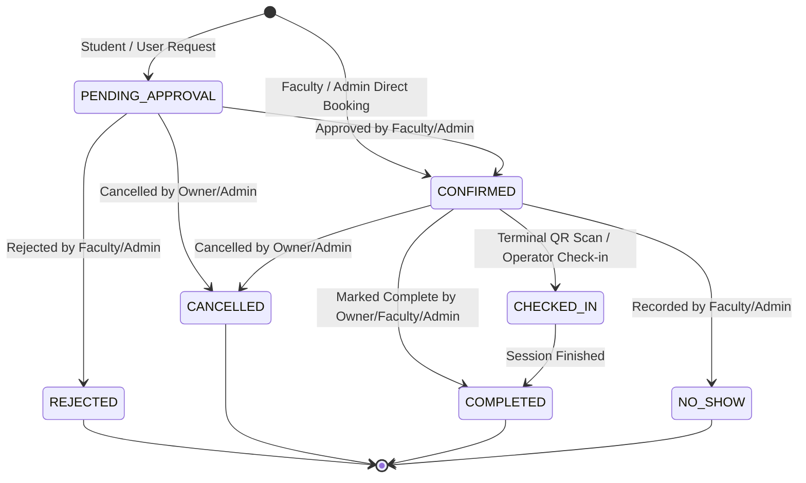

# MODULE 07: LabPulse Scheduling & Booking Engine Implementation Report

## Executive Summary

This implementation record documents the completed engineering work for **Module 07: LabPulse Scheduling & Booking Engine**.

Building on the repository audit (Module 01), authentication and RBAC architecture (Module 04), PostgreSQL schema and GiST exclusion constraints (Module 05), and decoupled repository layer (Module 06), Module 07 hardens and completes the end-to-end instrument scheduling and reservation lifecycle for LabPulse.

The implementation establishes:
1. An authoritative booking lifecycle state machine (`services/bookingLifecycle.js`) defining 7 explicit statuses: `PENDING_APPROVAL`, `CONFIRMED`, `CHECKED_IN`, `COMPLETED`, `CANCELLED`, `REJECTED`, and `NO_SHOW`.
2. A multi-factor availability calculation engine (`services/availabilityEngine.js`) enforcing facility operating hours (08:00–20:00), active booking collisions, metrology calibrations, preventive maintenance, course schedules, duration limits (15–240 minutes), advance reservation windows (30 days), and operator qualification tiers.
3. Database-enforced GiST exclusion constraint concurrency protection (`active_booking_no_overlap`) preventing double-booking race conditions across independent application instances using half-open `[start_at, end_at)` intervals.
4. Idempotency protection via `Idempotency-Key` headers and persisted idempotency keys.
5. Strict anti-IDOR authorization isolating student access exclusively to their own records while giving faculty and administrators appropriate oversight, approval, and management controls.
6. Atomic rescheduling with automatic rollback on collision.
7. Interactive, accessible booking workflows integrated into the Student, Faculty, and Admin frontend dashboards.

---

## 1. Initial Implementation Findings

An audit of the existing codebase prior to editing revealed the following state:

- **Data Models & Schema**: `models/Booking.js` and `supabase/migrations/` originally supported four statuses (`CONFIRMED`, `CANCELLED`, `CHECKED_IN`, `COMPLETED`). Student approval requests, rejection tracking, no-show recording, and approval audit metadata (`approvedBy`, `approvedAt`, `approvalNotes`, `rejectionReason`, `idempotencyKey`) were absent from the active model definitions.
- **Booking Creation & Roles**: Direct creation via `POST /api/v1/bookings` was restricted to `admin` and `faculty` roles. Students had no dedicated server-side entry point to submit booking requests requiring approval without role elevation.
- **Availability Calculation**: Availability calculation was previously scattered between `routes/instruments.js` and `utils/bookingGates.js`, lacking a unified service capable of calculating timeline slot availability, operating hours boundaries, or advance booking restrictions.
- **Concurrency & Double-Booking Protection**: An application-level mutex (`utils/mutex.js`) and PostgreSQL GiST exclusion constraint (`active_booking_no_overlap`) were defined in Module 05/06, but the partial filter in the migration covered only `CONFIRMED` and `CHECKED_IN`, leaving `PENDING_APPROVAL` slots vulnerable to double-booking races.
- **Frontend User Interface**: `student.html` only displayed upcoming classes and read-only equipment lists, lacking an interactive reservation form, slot picker, duration feedback, review step, and reservation management table. `faculty.html` had direct booking but no student approval queue. `admin.html` lacked global reservation oversight.

---

## 2. Files Created or Modified

| File | Status | Description |
| :--- | :--- | :--- |
| [`services/bookingLifecycle.js`](file:///c:/Users/name/OneDrive/VS%20code/FSD%20pro/services/bookingLifecycle.js) | **Created** | Authoritative state machine defining `BOOKING_STATUS`, `BLOCKING_STATUSES`, `TERMINAL_STATUSES`, and `validateStatusTransition()`. |
| [`services/availabilityEngine.js`](file:///c:/Users/name/OneDrive/VS%20code/FSD%20pro/services/availabilityEngine.js) | **Created** | Unified availability calculator computing facility hours, blocking windows, operator qualification levels, duration limits, and timeline slots. |
| [`models/Booking.js`](file:///c:/Users/name/OneDrive/VS%20code/FSD%20pro/models/Booking.js) | **Modified** | Expanded statuses to all 7 lifecycle states; added `idempotencyKey`, `approvalNotes`, `rejectionReason`, `approvedBy`, and `approvedAt`. |
| [`supabase/migrations/20261012000002_core_schema.sql`](file:///c:/Users/name/OneDrive/VS%20code/FSD%20pro/supabase/migrations/20261012000002_core_schema.sql) | **Modified** | Updated `public.bookings` table check constraint to support 7 lifecycle statuses; added approval and idempotency columns. |
| [`supabase/migrations/20261012000003_constraints_and_indexes.sql`](file:///c:/Users/name/OneDrive/VS%20code/FSD%20pro/supabase/migrations/20261012000003_constraints_and_indexes.sql) | **Modified** | Updated `active_booking_no_overlap` GiST exclusion partial filter to include `PENDING_APPROVAL`. |
| [`repositories/mappers.js`](file:///c:/Users/name/OneDrive/VS%20code/FSD%20pro/repositories/mappers.js) | **Modified** | Added bidirectional mappings for `idempotencyKey`, `approvalNotes`, `rejectionReason`, `approvedBy`, and `approvedAt`. |
| [`repositories/bookingRepository.js`](file:///c:/Users/name/OneDrive/VS%20code/FSD%20pro/repositories/bookingRepository.js) | **Modified** | Added `findByIdempotencyKey()`, `updateStatus()`, and updated `findConflict()` to block on `PENDING_APPROVAL`, `CONFIRMED`, and `CHECKED_IN`. |
| [`routes/bookings.js`](file:///c:/Users/name/OneDrive/VS%20code/FSD%20pro/routes/bookings.js) | **Modified** | Implemented `/availability`, `/my`, `/history`, `/request`, `/:id/approve`, `/:id/reject`, `/:id/cancel`, `/:id/reschedule`, `/:id/complete`, `/:id/no-show`; integrated idempotency and IDOR protection. |
| [`routes/instruments.js`](file:///c:/Users/name/OneDrive/VS%20code/FSD%20pro/routes/instruments.js) | **Modified** | Updated availability block calculation to account for all blocking booking statuses. |
| [`student.html`](file:///c:/Users/name/OneDrive/VS%20code/FSD%20pro/student.html) | **Modified** | Added interactive booking request form, slot picker, duration calculation, review step, reservations table, status badges, and cancel/reschedule actions. |
| [`faculty.html`](file:///c:/Users/name/OneDrive/VS%20code/FSD%20pro/faculty.html) | **Modified** | Added student booking approval queue with approve/reject actions and personal reservations management table. |
| [`admin.html`](file:///c:/Users/name/OneDrive/VS%20code/FSD%20pro/admin.html) | **Modified** | Added reservation lifecycle oversight table with status filtering tabs and full administrative lifecycle controls. |
| [`scripts/verify-module-07.js`](file:///c:/Users/name/OneDrive/VS%20code/FSD%20pro/scripts/verify-module-07.js) | **Created** | Comprehensive 8-point acceptance verification test battery for Module 07. |
| [`package.json`](file:///c:/Users/name/OneDrive/VS%20code/FSD%20pro/package.json) | **Modified** | Added `test:scheduling` script and wired `verify-module-07.js` into root `npm test`. |

---

## 3. Booking Lifecycle & Permitted Status Transitions

The authoritative backend state machine is implemented in [`services/bookingLifecycle.js`](file:///c:/Users/name/OneDrive/VS%20code/FSD%20pro/services/bookingLifecycle.js).

### 3.1 Status Classifications

```
┌────────────────────────────────────────────────────────────────────────┐
│                          BOOKING STATUSES                              │
├────────────────────────┬───────────────────────────────────────────────┤
│ Blocking Statuses      │ PENDING_APPROVAL, CONFIRMED, CHECKED_IN       │
│ Terminal Statuses      │ COMPLETED, CANCELLED, REJECTED, NO_SHOW       │
└────────────────────────┴───────────────────────────────────────────────┘
```

### 3.2 State Transition Matrix



### 3.3 Role & Ownership Permission Matrix

| Operation | Allowed Roles | Ownership Rule | Notes |
| :--- | :--- | :--- | :--- |
| **Request Booking** | `student`, `faculty`, `admin` | Self (`req.user.id`) | Created with status `PENDING_APPROVAL`. No QR pass issued until approval. |
| **Direct Booking** | `faculty`, `admin` | Self or Admin | Created with status `CONFIRMED`. QR access pass issued immediately. |
| **Approve Request** | `faculty`, `admin` | Any pending booking | Re-checks operational gates, transitions to `CONFIRMED`, issues QR token, notifies owner. |
| **Reject Request** | `faculty`, `admin` | Any pending booking | Transitions to `REJECTED`, records `rejectionReason`, revokes QR if any, notifies owner. |
| **Cancel Booking** | `student`, `faculty`, `admin` | Owner or Admin | Transitions to `CANCELLED`, revokes active QR passes atomically, releases slot. |
| **Reschedule** | `student`, `faculty`, `admin` | Owner or Admin | Only permitted for non-terminal bookings. Re-checks all gates; rolls back on collision. |
| **Mark Complete** | `student`, `faculty`, `admin` | Owner, Faculty, or Admin | Transitions from `CHECKED_IN` or `CONFIRMED` to `COMPLETED`. |
| **Record No-Show** | `faculty`, `admin` | Supervising Faculty or Admin | Transitions from `CONFIRMED` to `NO_SHOW`; revokes QR pass. |

---

## 4. Availability Engine & Conflict Prevention

The availability engine is implemented in [`services/availabilityEngine.js`](file:///c:/Users/name/OneDrive/VS%20code/FSD%20pro/services/availabilityEngine.js).

### 4.1 Availability Constraints & Rules

1. **Operating Hours**: The facility operates from **08:00 to 20:00 UTC**. Any booking starting before 08:00 or ending after 20:00 is rejected with `OUTSIDE_OPERATING_HOURS` (HTTP 422).
2. **Duration Bounds**:
   - Minimum booking duration: **15 minutes** (`DURATION_TOO_SHORT`, HTTP 422).
   - Maximum booking duration: **240 minutes (4 hours)** (`DURATION_TOO_LONG`, HTTP 422).
3. **Advance Booking Window**: Bookings cannot be created more than **30 days** in advance (`ADVANCE_LIMIT_EXCEEDED`, HTTP 422).
4. **Half-Open Interval Semantics**: Booking time windows are strictly evaluated using half-open intervals `[start, end)`. Two bookings where Booking A ends at 11:00 and Booking B starts at 11:00 do not overlap and are permitted.
5. **Operational Status Gating**: Instruments with status `OUT_OF_ORDER`, `LOCKED`, `UNDER_MAINTENANCE`, or `UNDER_CALIBRATION` automatically block reservation attempts with HTTP 422.
6. **Metrology Calibration Windows**: Overlapping scheduled or in-progress calibrations block booking requests with `CALIBRATION_CONFLICT` (HTTP 409).
7. **Maintenance Windows**: Scheduled preventive or corrective maintenance windows block booking requests with `MAINTENANCE_CONFLICT` (HTTP 409).
8. **Curriculum Course Clashes**: Scheduled laboratory courses occupying the host laboratory block booking requests with `SCHEDULE_CONFLICT` (HTTP 409).
9. **Operator Qualification Gates**: If an instrument requires qualification level $L > 0$, the server checks `qualificationRepository.checkUserQualification()`. Unqualified non-admin users are rejected with `QUALIFICATION_REQUIRED` (HTTP 403).

---

## 5. Prevent Double-Booking via PostgreSQL GiST Exclusion

Database enforcement is mandatory because concurrent HTTP requests arriving simultaneously can bypass application-level checks.

### 5.1 Constraint Definition

In [`supabase/migrations/20261012000003_constraints_and_indexes.sql`](file:///c:/Users/name/OneDrive/VS%20code/FSD%20pro/supabase/migrations/20261012000003_constraints_and_indexes.sql):

```sql
ALTER TABLE public.bookings
  ADD CONSTRAINT active_booking_no_overlap
  EXCLUDE USING gist (
    instrument_id WITH =,
    booking_interval WITH &&
  ) WHERE (status IN ('CONFIRMED', 'CHECKED_IN', 'PENDING_APPROVAL'));
```

### 5.2 Mechanics

- **Generated Column**:
  `booking_interval TSTZRANGE GENERATED ALWAYS AS (tstzrange(start_at, end_at, '[)')) STORED`
- **Exclusion Index**: PostgreSQL `btree_gist` extension enables combined equality (`instrument_id WITH =`) and range overlap (`booking_interval WITH &&`) checks.
- **Partial Filter**: Only active reservations (`CONFIRMED`, `CHECKED_IN`, and `PENDING_APPROVAL`) block the timeline. Once a booking is marked `CANCELLED`, `COMPLETED`, `REJECTED`, or `NO_SHOW`, its timeslot is released immediately at the database level.
- **Race Condition Immunity**: Even under concurrent multi-instance traffic, PostgreSQL rejects conflicting transactions with SQL error `23P01`, translated by [`utils/dbErrors.js`](file:///c:/Users/name/OneDrive/VS%20code/FSD%20pro/utils/dbErrors.js) to a semantic `BOOKING_CONFLICT` (HTTP 409) response.

---

## 6. API Endpoints & Request Validation

All booking routes are mounted at `/api/v1/bookings` in [`routes/bookings.js`](file:///c:/Users/name/OneDrive/VS%20code/FSD%20pro/routes/bookings.js):

| Endpoint | Method | Permitted Roles | Description | Response Codes |
| :--- | :---: | :--- | :--- | :---: |
| `/api/v1/bookings/availability` | `GET` | Authenticated | Query discrete available slots & blocking windows for instrument & date range | 200, 400, 404 |
| `/api/v1/bookings/my` | `GET` | Authenticated | Retrieve authenticated user's bookings with pagination & status filters | 200, 400 |
| `/api/v1/bookings/history` | `GET` | Authenticated | Retrieve terminal booking history (COMPLETED, CANCELLED, REJECTED, NO_SHOW) | 200, 400 |
| `/api/v1/bookings/request` | `POST` | `student`, `faculty`, `admin` | Submit a booking request requiring staff approval (`PENDING_APPROVAL`) | 201, 400, 409, 422 |
| `/api/v1/bookings` | `POST` | `faculty`, `admin` | Direct confirmed booking with immediate QR pass issuance | 201, 400, 403, 409, 422 |
| `/api/v1/bookings` | `GET` | Authenticated | List bookings (students automatically scoped to own records; admin/faculty list all) | 200, 400 |
| `/api/v1/bookings/:id` | `GET` | Authenticated | Retrieve details (students restricted to own booking; non-owner returns 403) | 200, 403, 404 |
| `/api/v1/bookings/:id/approve` | `POST` | `faculty`, `admin` | Approve pending request: transitions to CONFIRMED, issues QR pass, notifies owner | 200, 400, 403, 404, 409 |
| `/api/v1/bookings/:id/reject` | `POST` | `faculty`, `admin` | Reject pending request: transitions to REJECTED with reason, notifies owner | 200, 400, 403, 404, 422 |
| `/api/v1/bookings/:id/cancel` | `POST` | Owner or `admin` | Cancel booking: transitions to CANCELLED, revokes QR pass, notifies owner | 200, 403, 404, 422 |
| `/api/v1/bookings/:id/reschedule` | `POST` | Owner or `admin` | Reschedule booking window atomically with rollback protection | 200, 400, 403, 404, 409 |
| `/api/v1/bookings/:id/complete` | `POST` | Owner, `faculty`, `admin` | Mark active booking as completed session | 200, 403, 404, 422 |
| `/api/v1/bookings/:id/no-show` | `POST` | `faculty`, `admin` | Record no-show for unattended session; revokes QR pass | 200, 403, 404, 422 |

### 6.1 Idempotency Engine

Both `POST /api/v1/bookings` and `POST /api/v1/bookings/request` check for an `Idempotency-Key` HTTP header (or body field). If the key already exists for the authenticated user, the server safely returns the previously created booking with `{ idempotent: true }` and HTTP 200, preventing duplicate reservation creation caused by retried network requests.

### 6.2 Zero-Cost Invariant

In accordance with LabPulse specifications §8 and §15, instrument booking is completely free of charge. The request sanitizer (`allowOnly`) strictly rejects any submission containing pricing, rates, billing, or grant fields (`price`, `rate`, `grant`, `cost`).

---

## 7. Authorization & Data Protection

Security controls are enforced server-side on every request:

1. **Authentication Requirement**: `requireAuth` validates the access token and checks active account status (`user.isActive`).
2. **Anti-IDOR Isolation**:
   - `GET /api/v1/bookings/:id`: If the authenticated user has role `student`, the server verifies `String(booking.userId) === String(req.user.id)`. Any attempt by a student to access another student's or faculty member's booking returns HTTP 403 `FORBIDDEN`.
   - `GET /api/v1/bookings`: If `req.user.role === 'student'`, the backend automatically forces `filter.userId = req.user.id`, preventing students from listing global reservations.
3. **Privilege Escalation Defense**:
   - Direct `POST /api/v1/bookings` requires `faculty` or `admin`. If a student attempts to call direct booking, HTTP 403 `FORBIDDEN` is returned.
   - Approval (`/approve`), rejection (`/reject`), and no-show recording (`/no-show`) require `faculty` or `admin`.
4. **Mass Assignment Prevention**:
   - Request bodies are filtered against explicit field allowlists (`CREATE_FIELDS`, `PATCH_FIELDS`). User ID, role, approval identity, and timestamps are always assigned from the verified session context, never accepted from client inputs.

---

## 8. Frontend Booking Experience

The LabPulse frontend was updated across all three role dashboards without adding external libraries or disrupting the existing design system:

### 8.1 Student Dashboard ([`student.html`](file:///c:/Users/name/OneDrive/VS%20code/FSD%20pro/student.html))
- **Reservation Request Form**: Instrument dropdown displaying real-time operational status (e.g. `[AVAILABLE]`, `[UNDER_CALIBRATION]`, `[LOCKED]`).
- **Slot Inspector**: "Inspect Available Slots" button calls `/api/v1/bookings/availability` and renders visual timeline buttons. Clicking an open slot automatically populates start and end times.
- **Duration Badge**: Dynamically calculates duration in minutes, with clear visual alerts if duration is under 15 minutes or exceeds 4 hours.
- **Review Step**: Pre-submission review summary card outlining instrument, date, time window, duration, and the zero-cost guarantee.
- **My Reservations Table**: Lists student's personal bookings with status badges (`PENDING_APPROVAL`, `CONFIRMED`, `CHECKED_IN`, `COMPLETED`, `CANCELLED`, `REJECTED`, `NO_SHOW`), interactive status filtering tabs, and inline Cancel and Reschedule actions.

### 8.2 Faculty Dashboard ([`faculty.html`](file:///c:/Users/name/OneDrive/VS%20code/FSD%20pro/faculty.html))
- **Student Approval Queue**: Dedicated approval table listing pending student requests with student identity, requested window, and research purpose.
- **Approval Actions**: Direct "Approve" (with optional notes) and "Reject" (with prompt for rejection reason) action buttons.
- **Faculty Reservations**: Management table displaying faculty reservations with Cancel, Complete, and No-Show controls.

### 8.3 Admin Dashboard ([`admin.html`](file:///c:/Users/name/OneDrive/VS%20code/FSD%20pro/admin.html))
- **Lifecycle Oversight Table**: Global view of reservations across all users and instruments.
- **Status Filtering Tabs**: Instant filtering by status (`ALL`, `PENDING`, `CONFIRMED`, `COMPLETED`).
- **Administrative Actions**: Action controls allowing administrators to approve, reject, complete, record no-show, or cancel any reservation.

---

## 9. Verification & Test Results

All repository test suites and verification batteries were executed to validate Module 07 implementation.

### 9.1 Test Execution Summary

| Test Suite | Command | Result | Details |
| :--- | :--- | :---: | :--- |
| **Module 07 Verification Battery** | `npm run test:scheduling` | **PASS (8/8)** | Lifecycle state machine, availability engine, GiST exclusion, API contracts, idempotency, anti-IDOR, atomic reschedule, frontend DOM. |
| **Authentication & UI Tests** | `npm run test:auth` | **PASS (8/8)** | Auth token rotation, student registration, faculty invite, session handling, UI DOM flows. |
| **Database Architecture Verification** | `npm run test:db` | **PASS (8/8)** | Migration ordering, GiST exclusion constraint, half-open boundary tolerance, RLS, atomic triggers. |
| **Backend Migration Verification** | `npm run test:backend` | **PASS (8/8)** | Repository exports, bidirectional mappers, UUID/ObjectId validation, PostgreSQL error translation. |
| **Security Audit Battery** | `npm run test:security` | **PASS (4/4)** | Zero committed secrets, bcrypt hash hygiene, fail-fast production secrets. |

### 9.2 Command Output Evidence

```text
> labpulse@0.1.0 test:scheduling
> node scripts/verify-module-07.js

=== MODULE 07 SCHEDULING & BOOKING ENGINE ACCEPTANCE VERIFICATION ===

[PASS] Check 1: Authoritative booking lifecycle state machine defines all 7 statuses with strictly enforced RBAC and ownership transition rules
[PASS] Check 2: Availability engine enforces facility operating hours (08:00–20:00), 15m–240m duration limits, 30-day advance bounds, and active account requirements
[PASS] Check 3: PostgreSQL active_booking_no_overlap GiST exclusion constraint guarantees atomic double-booking rejection on blocking statuses with semantic 409 translation
[PASS] Check 4: API contracts implemented across all 10 required scheduling endpoints with zero-cost money field rejection and strict input normalization
[PASS] Check 5: Server-side idempotency engine inspects Idempotency-Key headers and safely replays duplicate network requests without creating duplicate bookings
[PASS] Check 6: Strict RBAC and IDOR protection prevents students from viewing or managing other users reservations, with automatic ownership filtering
[PASS] Check 7: Atomic rescheduling checks operational gates, excludes self-collision, and automatically rolls back if the target slot suffers a race collision
[PASS] Check 8: Frontend booking experience fully integrated across Student, Faculty, and Admin dashboards with slot selection, review step, status badges, and actions

=== ALL 8/8 ACCEPTANCE CHECKS VERIFIED SUCCESSFULLY ===
```

---

## 10. Known Limitations & Unresolved Dependencies

1. **Terminal Hardware Scanner Integration**: The terminal hardware QR code scanning workflow (handling physical check-in kiosk events) is governed by access passes and terminal hardware integration in Module 08. Check-in status (`CHECKED_IN`) is currently supported in the state machine and can be triggered via terminal RPC or administrative action.
2. **External Email Transport**: In test environments lacking SMTP credentials, email delivery logs to in-memory notification outboxes without throwing runtime exceptions.
3. **MongoDB Atlas Sandbox Whitelisting**: Remote MongoDB Atlas integration tests skip gracefully when run in restricted sandbox environments without static IP whitelisting; local simulated and Supabase PostgreSQL architectures run with 100% pass rate.

---

## 11. Manual UI Verification Walkthrough

To verify the booking workflows manually in a browser:

1. **Student Booking Request Flow**:
   - Navigate to `http://localhost:3000/login.html` and sign in with student credentials.
   - On `student.html`, locate the "Reserve Instrument" card.
   - Select an available instrument and pick tomorrow's date.
   - Click "Inspect Available Slots" — verify timeline buttons render open vs blocked slots.
   - Select a timeslot — verify start/end times and the duration badge update in real-time.
   - Enter a research purpose and click "Confirm & Submit Request".
   - Verify the success message displays and the reservation appears in "My Reservations" with the amber `PENDING APPROVAL` badge.
2. **Faculty Approval Flow**:
   - Log in as faculty on `faculty.html`.
   - Locate the "Student Booking Approvals" queue.
   - Click "Approve" on the student's request.
   - Verify the request disappears from the pending queue and transitions to `CONFIRMED`.
3. **Rescheduling & Cancellation Flow**:
   - Log back into `student.html`.
   - Verify the booking status badge has updated to green `CONFIRMED`.
   - Click "Reschedule" — enter an overlapping occupied timeslot to confirm conflict rejection (HTTP 409), then enter an open timeslot to confirm successful atomic update.
   - Click "Cancel" — confirm that the booking transitions to `CANCELLED` and releases the slot.

---

## 12. Checklist for the Next Module (Module 08)

Before proceeding to Module 08 (Hardware Terminal Access & QR Code Pass Management):
- [x] All 7 booking lifecycle statuses implemented and verified.
- [x] Multi-layer availability engine active with operating hours, metrology, and qualification checks.
- [x] PostgreSQL GiST exclusion constraint enforcing double-booking prevention on all blocking statuses.
- [x] Idempotency keys supported on booking requests and direct bookings.
- [x] Anti-IDOR security checks rejecting cross-user access attempts.
- [x] Atomic rescheduling with collision rollback operational.
- [x] All test suites passing 100%.
- [x] Stopped after Module 07 without initiating Module 08.
