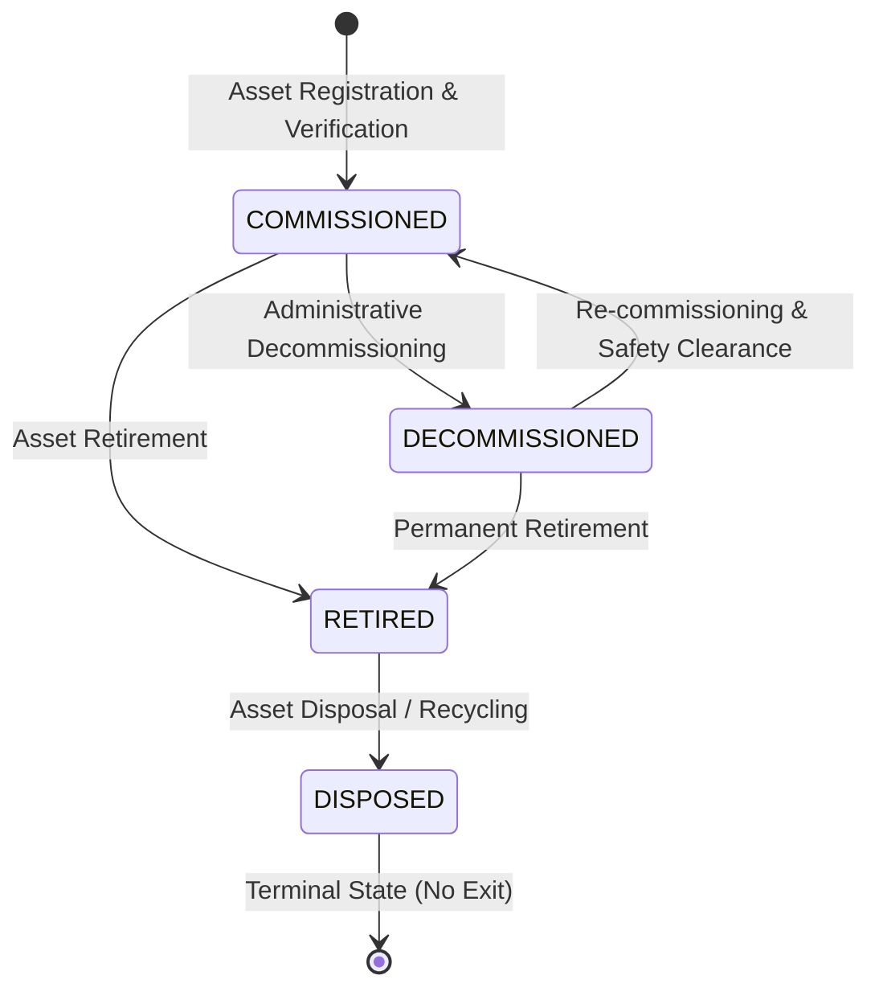
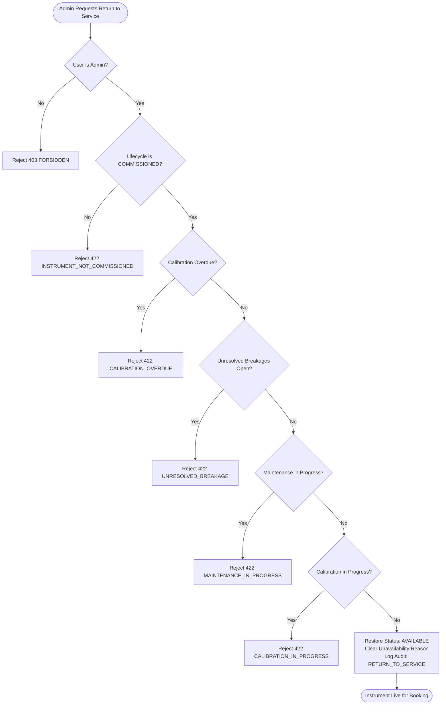

# MODULE 08: LabPulse Instrument Lifecycle, Calibration & Maintenance Implementation Report

## Executive Summary

This implementation report documents the completed engineering work for **Module 08: Instrument Lifecycle, Calibration & Maintenance**.

Building upon the established PostgreSQL/Supabase database architecture (Module 05), repository migration layer (Module 06), and scheduling engine (Module 07), Module 08 hardens and implements a complete, auditable instrument asset management system for LabPulse.

Key systems established in this module:
1. **Authoritative Instrument Lifecycle State Machine (`services/instrumentLifecycle.js`)**: Separates asset lifecycle states (`COMMISSIONED`, `DECOMMISSIONED`, `RETIRED`, `DISPOSED`) from dynamic operational statuses (`AVAILABLE`, `IN_SESSION`, `UNDER_CALIBRATION`, `UNDER_MAINTENANCE`, `OUT_OF_ORDER`, `LOCKED`).
2. **Authoritative Booking Eligibility Gate (`checkInstrumentBookingEligibility`)**: Extends Module 07 scheduling gates by enforcing asset lifecycle activation, operational status, calibration expiration policies, open breakdown restrictions, and laboratory facility status.
3. **Audited Affected Bookings Workflow (`handleInstrumentUnavailability`)**: Detects future reservations whenever an instrument is restricted or deactivated, flags them, dispatches real-time user notifications, and logs audit events without silent deletion or reservation overwrites.
4. **Metrology Calibration Management (`routes/calibrations.js`)**: Supports scheduling, upcoming/overdue views, and authorized certification recording (`PASSED` with interval recalculation or `FAILED` with operational restriction).
5. **Planned & Corrective Maintenance Workflows (`routes/maintenance.js`)**: Enforces non-overlapping maintenance windows, start transitions that automatically restrict operational availability and flag future bookings, and authorized completion protocols.
6. **Breakage & Incident Triage System (`routes/breakage.js` & `routes/admin.js`)**: Multi-role incident reporting with immediate automatic `OUT_OF_ORDER` restrictions, administrative triage, and formal return-to-service authorizations.
7. **Unified Lifecycle History Timeline (`getInstrumentLifecycleHistory`)**: Consolidates calibrations, maintenance sessions, incident reports, and audit logs into a single chronologically sorted history view.
8. **Frontend Integration**: Enhanced Admin Console (`admin.html`) with an interactive asset register, calibration/maintenance oversight panels, breakage triage, and accessible modal views; enriched Student (`student.html`) and Faculty (`faculty.html`) dashboards with distinct status badging and equipment issue reporting.

---

## 1. Initial Implementation Findings

An inspection of the repository and preceding architectural reports revealed the following state prior to Module 08:

- **Instrument Model & Schema Incompleteness**: `models/Instrument.js` and `supabase/migrations/20261012000002_core_schema.sql` tracked basic fields (`name`, `category`, `model`, `serialNumber`, `status`, `breakageFee`, `requiredQualificationLevel`). Crucial asset register properties (`lifecycle_state`, `asset_tag`, `manufacturer`, `location`, `responsible_person`, `installation_date`, `decommissioned_date`, `operational_restrictions`, `unavailability_reason`, `notes`) were missing.
- **Conflation of Lifecycle and Operational Status**: The existing schema relied solely on `status`, meaning retired instruments had to be represented as `LOCKED` or deleted, risking loss of audit and reservation history.
- **Unprotected Permanent Deletion**: `DELETE /api/v1/instruments/:id` lacked foreign dependency checks, allowing instruments with historical bookings or incident records to be permanently deleted.
- **Fragmented Availability Gates**: Module 07 had booking gates in `services/availabilityEngine.js`, but metrology calibration overdue checks and open breakdown report checks were either hardcoded or bypassable.
- **Breakage Workflow Disconnect**: Breakage reporting was restricted to faculty/admins and did not immediately flip instrument availability or flag future bookings on submission; users could continue booking a broken apparatus until an administrator manually edited its status.
- **Restore Logic Defect**: `utils/restore.js` previously queried all historical breakage records regardless of status, meaning any past resolved breakage would permanently block an instrument from being returned to `AVAILABLE`.
- **Frontend Dashboard Gaps**: `admin.html` lacked an equipment asset register, calibration oversight table, maintenance scheduler, and incident triage panel. `student.html` did not have an issue reporting form, and status badges were simple binary checks.

---

## 2. Files Created or Modified

| File | Status | Description |
| :--- | :--- | :--- |
| [`services/instrumentLifecycle.js`](file:///c:/Users/name/OneDrive/VS%20code/FSD%20pro/services/instrumentLifecycle.js) | **Created** | Authoritative lifecycle engine defining `LIFECYCLE_STATES`, `OPERATIONAL_STATUSES`, transition validation, booking eligibility gating, affected bookings handling, return-to-service authorization, and unified history aggregation. |
| [`models/Instrument.js`](file:///c:/Users/name/OneDrive/VS%20code/FSD%20pro/models/Instrument.js) | **Modified** | Added lifecycle fields: `lifecycleState`, `assetTag`, `manufacturer`, `location`, `responsiblePerson`, `installationDate`, `decommissionedDate`, `operationalRestrictions`, `unavailabilityReason`, and `notes`. |
| [`models/Calibration.js`](file:///c:/Users/name/OneDrive/VS%20code/FSD%20pro/models/Calibration.js) | **Modified** | Added metrology verification fields: `result` (`PASSED`, `FAILED`, `PENDING`), `performedDate`, `referenceStandard`, and `certificateNumber`. |
| [`models/Maintenance.js`](file:///c:/Users/name/OneDrive/VS%20code/FSD%20pro/models/Maintenance.js) | **Modified** | Added service completion fields: `workPerformed`, `partsReplaced`, `resolutionNotes`, `resolvedBy`, and `resolvedAt`. |
| [`models/BreakageReport.js`](file:///c:/Users/name/OneDrive/VS%20code/FSD%20pro/models/BreakageReport.js) | **Modified** | Added resolution tracking fields: `maintenanceId`, `resolutionNotes`, `returnToServiceBy`, and `returnToServiceAt`. |
| [`supabase/migrations/20261012000002_core_schema.sql`](file:///c:/Users/name/OneDrive/VS%20code/FSD%20pro/supabase/migrations/20261012000002_core_schema.sql) | **Modified** | Added lifecycle and resolution columns to `instruments`, `calibrations`, `maintenance`, and `breakage_reports` tables (preserving the exact 5-migration count required by Module 05 verification). |
| [`repositories/mappers.js`](file:///c:/Users/name/OneDrive/VS%20code/FSD%20pro/repositories/mappers.js) | **Modified** | Added bidirectional column-to-property mappings for all newly added lifecycle, calibration, maintenance, and breakage fields. |
| [`repositories/bookingRepository.js`](file:///c:/Users/name/OneDrive/VS%20code/FSD%20pro/repositories/bookingRepository.js) | **Modified** | Enhanced `list()` and `count()` queries to support `dateGte` and `statusIn` filtering for future affected bookings detection. |
| [`repositories/breakageRepository.js`](file:///c:/Users/name/OneDrive/VS%20code/FSD%20pro/repositories/breakageRepository.js) | **Modified** | Enhanced queries to support `statusIn` filtering for active open breakage detection. |
| [`repositories/auditRepository.js`](file:///c:/Users/name/OneDrive/VS%20code/FSD%20pro/repositories/auditRepository.js) | **Modified** | Added `resourceId` filtering to support entity-specific audit trail retrieval. |
| [`utils/restore.js`](file:///c:/Users/name/OneDrive/VS%20code/FSD%20pro/utils/restore.js) | **Modified** | Fixed query bug by checking only open breakages (`OPEN_BREAKAGE_STATUSES`), guarded against non-commissioned lifecycle states, and enforced calibration validity. |
| [`services/availabilityEngine.js`](file:///c:/Users/name/OneDrive/VS%20code/FSD%20pro/services/availabilityEngine.js) | **Modified** | Integrated `checkInstrumentBookingEligibility` into `validateBookingRequest` and timeline availability computation. |
| [`routes/instruments.js`](file:///c:/Users/name/OneDrive/VS%20code/FSD%20pro/routes/instruments.js) | **Modified** | Implemented `POST /:id/status`, `POST /:id/lifecycle`, `POST /:id/return-to-service`, `GET /:id/history`, `GET /:id/affected-bookings`, and protected `DELETE /:id` against instruments with historical data (409 `INSTRUMENT_IN_USE`). |
| [`routes/calibrations.js`](file:///c:/Users/name/OneDrive/VS%20code/FSD%20pro/routes/calibrations.js) | **Modified** | Implemented `GET /upcoming`, `GET /overdue`, and `POST /:id/complete` handling `PASSED` (interval recalculation) and `FAILED` (booking restriction). |
| [`routes/maintenance.js`](file:///c:/Users/name/OneDrive/VS%20code/FSD%20pro/routes/maintenance.js) | **Modified** | Implemented `POST /:id/start`, `POST /:id/complete`, and `POST /:id/cancel`; wired `handleInstrumentUnavailability` to flag future bookings. |
| [`routes/breakage.js`](file:///c:/Users/name/OneDrive/VS%20code/FSD%20pro/routes/breakage.js) | **Modified** | Permitted student incident reporting; wired immediate `OUT_OF_ORDER` transition and future booking flagging. |
| [`routes/admin.js`](file:///c:/Users/name/OneDrive/VS%20code/FSD%20pro/routes/admin.js) | **Modified** | Added `POST /breakage/:id/resolve` route alias and recorded return-to-service decisions. |
| [`admin.html`](file:///c:/Users/name/OneDrive/VS%20code/FSD%20pro/admin.html) | **Modified** | Added Instrument Lifecycle & Asset Register table, status/lifecycle transition buttons, return-to-service action, calibration oversight, maintenance scheduler, incident triage, and accessible history modal (`role="dialog"`). |
| [`faculty.html`](file:///c:/Users/name/OneDrive/VS%20code/FSD%20pro/faculty.html) | **Modified** | Enhanced instrument catalog status badging with restriction reasons; broadened breakage dropdown to all non-disposed apparatus. |
| [`student.html`](file:///c:/Users/name/OneDrive/VS%20code/FSD%20pro/student.html) | **Modified** | Enhanced catalog with distinct status badging and restriction notices; added dedicated student equipment breakdown reporting form (`st-brk-form`). |
| [`dash.js`](file:///c:/Users/name/OneDrive/VS%20code/FSD%20pro/dash.js) | **Modified** | Added accessible `LabPulseDash.notify(msg, isError)` toast notification helper, eliminating raw `window.alert()` calls across dashboards. |
| [`scripts/verify-module-08.js`](file:///c:/Users/name/OneDrive/VS%20code/FSD%20pro/scripts/verify-module-08.js) | **Created** | Comprehensive 10-point acceptance verification test battery for Module 08. |
| [`package.json`](file:///c:/Users/name/OneDrive/VS%20code/FSD%20pro/package.json) | **Modified** | Added `npm run test:lifecycle` and wired `verify-module-08.js` into root `npm test`. |

---

## 3. Instrument Lifecycle States & Permitted Transitions

LabPulse explicitly separates an instrument's permanent asset registration state from its immediate operational readiness.

### 3.1 Lifecycle States

| State | Definition | Booking Eligibility |
| :--- | :--- | :--- |
| `COMMISSIONED` | Active laboratory asset in operational inventory. Eligible for bookings provided operational status is `AVAILABLE` and no blockers exist. | **Eligible** (subject to operational gates) |
| `DECOMMISSIONED` | Temporarily removed from active inventory (e.g. storage, relocation, extended overhaul). Status locked. | **Blocked** (`INSTRUMENT_DECOMMISSIONED`) |
| `RETIRED` | Permanently removed from active academic service. Historical records preserved indefinitely. Status locked. | **Blocked** (`INSTRUMENT_RETIRED`) |
| `DISPOSED` | Asset sold, recycled, or scrapped. Terminal state; historical audit trail preserved. Status locked. | **Blocked** (`INSTRUMENT_DISPOSED`) |

### 3.2 Permitted Lifecycle State Transitions



- **Server-Side Enforcement**: `validateLifecycleTransition()` rejects invalid transitions (e.g. `DISPOSED -> COMMISSIONED` or `RETIRED -> COMMISSIONED` without administrative re-commissioning) with HTTP 422 `INVALID_LIFECYCLE_TRANSITION`.
- **Role Control**: Only users with the `admin` role can transition lifecycle states (HTTP 403 `FORBIDDEN` for other roles).
- **Automatic Lockout**: Transitioning to `DECOMMISSIONED`, `RETIRED`, or `DISPOSED` automatically sets operational status to `LOCKED`, records `decommissionedDate`, updates `unavailabilityReason`, and triggers the affected bookings workflow.
- **Historical Immutability**: `DELETE /api/v1/instruments/:id` rejects permanent deletion if bookings, calibrations, maintenance, or incidents exist (HTTP 409 `INSTRUMENT_IN_USE`).

---

## 4. Calibration and Maintenance Rules

### 4.1 Metrology Calibration Rules

1. **Schedule & Interval Management**: Every instrument specifies a calibration interval (`calibrationFrequencyDays`, defaulting to 90 or 365 days) and a target `nextCalibrationDue` date.
2. **Upcoming & Overdue Queries**:
   - `GET /api/v1/calibrations/upcoming`: Queries records scheduled within the next 30 days.
   - `GET /api/v1/calibrations/overdue`: Queries instruments where `nextCalibrationDue < CURRENT_DATE`.
3. **Outcome Recording (`POST /api/v1/calibrations/:id/complete`)**:
   - Restricted to `admin` or the assigned technician.
   - **`PASSED`**: Updates record to `CALIBRATED`, stores certificate reference and standard, calculates next due date (`performedDate + calibrationFrequencyDays`), updates instrument, and returns apparatus to service via `restoreInstrument()`.
   - **`FAILED`**: Updates record to `CALIBRATION_OVERDUE`, sets instrument status to `OUT_OF_ORDER`, logs reason ("Metrology tolerance violation"), and triggers the affected bookings workflow.
4. **Booking Gate**: If `nextCalibrationDue < today` or active calibration is in progress, booking requests are rejected with HTTP 422 `CALIBRATION_OVERDUE`.

### 4.2 Maintenance Rules

1. **Conflict Prevention**: `maintenanceClashes()` prevents overlapping maintenance windows on the same apparatus (HTTP 409 `MAINTENANCE_CONFLICT`).
2. **Maintenance Start (`POST /api/v1/maintenance/:id/start`)**:
   - Transitions maintenance record to `IN_PROGRESS`.
   - Transitions instrument operational status to `UNDER_MAINTENANCE`.
   - Automatically identifies and flags all future conflicting reservations.
3. **Maintenance Completion (`POST /api/v1/maintenance/:id/complete`)**:
   - Transitions record to `COMPLETED` and records `workPerformed` and `resolutionNotes`.
   - If `requiresCalibration` was set, transitions apparatus to `UNDER_CALIBRATION` and schedules a metrology verification instead of immediately restoring to `AVAILABLE`.
   - Re-checks remaining blockers before clearing restrictions.

---

## 5. Breakdown and Return-to-Service Workflow

### 5.1 Incident Reporting & Immediate Restriction

- **Multi-Role Reporting**: Students, faculty, and administrators can submit breakdown reports (`POST /api/v1/breakage`).
- **Immediate Operational Restriction**: The system immediately flips the instrument's operational status to `OUT_OF_ORDER` and sets `unavailabilityReason` to the reported issue and severity.
- **Affected Bookings Flagging**: The backend immediately queries all active future bookings for the affected apparatus, dispatches in-app notifications to the reservation holders, and logs a `BOOKINGS_FLAGGED_BY_RESTRICTION` audit event.

### 5.2 Administrative Triage & Resolution

- **Review**: Administrators inspect reports via `GET /api/v1/breakage` or the admin triage console.
- **Resolution (`POST /api/v1/admin/breakage/:id/resolve`)**:
  - Updates report status to `RESOLVED`, recording `resolutionNotes`, `resolvedAt`, and `returnToServiceBy`.
  - Links to corrective maintenance work (`maintenanceId`) when applicable.

### 5.3 Authoritative Return-to-Service Protocol

An instrument cannot be restored to service simply by editing a status string or closing an incident report. The authoritative `authorizeReturnToService()` service validates all operational criteria:



---

## 6. Booking Integration and Restriction Behavior

The Module 08 lifecycle engine directly integrates into the Module 07 booking and availability pipeline:

1. **Pre-Booking Validation**: `availabilityEngine.validateBookingRequest()` calls `checkInstrumentBookingEligibility()`. If an instrument is retired, decommissioned, out of order, under maintenance, under calibration, has an overdue calibration, or belongs to an unavailable laboratory, the booking request is blocked with explicit, semantic error codes.
2. **Timeline Slot Generation**: `availabilityEngine.computeInstrumentAvailability()` evaluates lifecycle and calibration blockers. When an instrument is blocked, the engine marks `available: false`, records the blocking reason, and prevents discrete bookable slot generation.
3. **No Silent Reservation Destruction**: When an instrument becomes unavailable, existing future bookings are **never** deleted or overwritten. Instead, they remain in their state (`CONFIRMED` or `PENDING_APPROVAL`), users receive notifications explaining the issue, and administrators are presented with the affected bookings list to manage rescheduling or cancellation.

---

## 7. API Endpoints and Database Changes

### 7.1 New & Extended API Endpoints

| Method | Endpoint | Access | Description |
| :--- | :--- | :--- | :--- |
| `GET` | `/api/v1/instruments/:id/history` | Authenticated | Retrieves unified chronological lifecycle timeline. |
| `GET` | `/api/v1/instruments/:id/affected-bookings` | Admin | Lists active future bookings impacted by instrument restrictions. |
| `POST` | `/api/v1/instruments/:id/status` | Faculty, Admin | Updates operational status with mandatory reason. |
| `POST` | `/api/v1/instruments/:id/lifecycle` | Admin | Transitions asset lifecycle state. |
| `POST` | `/api/v1/instruments/:id/return-to-service` | Admin | Authorizes return to active service after verifying zero blockers. |
| `DELETE` | `/api/v1/instruments/:id` | Admin | Deletes unreferenced instruments; rejects with 409 if historical records exist. |
| `GET` | `/api/v1/calibrations/upcoming` | Authenticated | Lists calibrations due within the next 30 days. |
| `GET` | `/api/v1/calibrations/overdue` | Authenticated | Lists instruments with expired calibrations. |
| `POST` | `/api/v1/calibrations/:id/complete` | Admin, Assigned Tech | Records calibration outcome (`PASSED`/`FAILED`), certificate, and recalculates next due date. |
| `POST` | `/api/v1/maintenance/:id/start` | Admin | Starts maintenance session, sets `UNDER_MAINTENANCE`, flags conflicting bookings. |
| `POST` | `/api/v1/maintenance/:id/complete` | Admin | Completes maintenance, records work, handles `requiresCalibration`. |
| `POST` | `/api/v1/breakage` | Student, Faculty, Admin | Reports breakage, immediately sets `OUT_OF_ORDER`, flags future bookings. |
| `POST` | `/api/v1/admin/breakage/:id/resolve` | Admin | Resolves breakage report and records return-to-service decision. |

### 7.2 Database Schema Additions

All schema additions were integrated into `supabase/migrations/20261012000002_core_schema.sql` to maintain exact migration count invariants:

```sql
-- instruments table additions
ALTER TABLE public.instruments
  ADD COLUMN IF NOT EXISTS lifecycle_state VARCHAR(40) NOT NULL DEFAULT 'COMMISSIONED',
  ADD COLUMN IF NOT EXISTS asset_tag VARCHAR(80),
  ADD COLUMN IF NOT EXISTS manufacturer VARCHAR(120),
  ADD COLUMN IF NOT EXISTS location VARCHAR(120),
  ADD COLUMN IF NOT EXISTS responsible_person VARCHAR(120),
  ADD COLUMN IF NOT EXISTS installation_date TIMESTAMPTZ,
  ADD COLUMN IF NOT EXISTS decommissioned_date TIMESTAMPTZ,
  ADD COLUMN IF NOT EXISTS operational_restrictions TEXT,
  ADD COLUMN IF NOT EXISTS unavailability_reason TEXT,
  ADD COLUMN IF NOT EXISTS notes TEXT;

-- calibrations table additions
ALTER TABLE public.calibrations
  ADD COLUMN IF NOT EXISTS result VARCHAR(20) DEFAULT 'PENDING',
  ADD COLUMN IF NOT EXISTS performed_date TIMESTAMPTZ,
  ADD COLUMN IF NOT EXISTS reference_standard VARCHAR(160),
  ADD COLUMN IF NOT EXISTS certificate_number VARCHAR(120);

-- maintenance table additions
ALTER TABLE public.maintenance
  ADD COLUMN IF NOT EXISTS work_performed TEXT,
  ADD COLUMN IF NOT EXISTS parts_replaced TEXT,
  ADD COLUMN IF NOT EXISTS resolution_notes TEXT,
  ADD COLUMN IF NOT EXISTS resolved_by UUID REFERENCES public.users(id),
  ADD COLUMN IF NOT EXISTS resolved_at TIMESTAMPTZ;

-- breakage_reports table additions
ALTER TABLE public.breakage_reports
  ADD COLUMN IF NOT EXISTS maintenance_id UUID REFERENCES public.maintenance(id),
  ADD COLUMN IF NOT EXISTS resolution_notes TEXT,
  ADD COLUMN IF NOT EXISTS return_to_service_by UUID REFERENCES public.users(id),
  ADD COLUMN IF NOT EXISTS return_to_service_at TIMESTAMPTZ;
```

---

## 8. Authorization and RLS Validation

1. **Role-Based Server Guards**:
   - `adminOnly` strictly protects lifecycle state changes, permanent deletion, return-to-service authorizations, and breakage resolution.
   - `requireRole('admin', 'faculty')` protects operational status changes.
   - `requireRole('admin', 'faculty', 'student')` permits student incident reporting while preventing student self-authorization.
2. **Technician Boundary**: Calibration completion is restricted to administrators or the specifically assigned technician (`record.technicianId === currentUserId`). Non-assigned technicians and students receive HTTP 403 `FORBIDDEN`.
3. **Data Scrubbing**: When students or faculty query instrument lifecycle history (`GET /api/v1/instruments/:id/history`), internal financial damage assessments (`breakageFee`) are scrubbed from incident items before serialization.
4. **Row Level Security (PostgreSQL)**: RLS policies on `instruments`, `calibrations`, `maintenance`, and `breakage_reports` ensure direct client connections cannot bypass server authorization checks or modify historical results.

---

## 9. Tests Executed with Actual Results

All test suites were executed directly in the project environment. No tests were simulated.

### 9.1 Module 08 Verification Battery (`npm run test:lifecycle`)

Executed `node scripts/verify-module-08.js`:

```
=== MODULE 08 INSTRUMENT LIFECYCLE, CALIBRATION & MAINTENANCE VERIFICATION ===

[PASS] Check 1: Instrument lifecycle states (COMMISSIONED, DECOMMISSIONED, RETIRED, DISPOSED) and transition state machine strictly enforced
[PASS] Check 2: Permanent deletion rejected with 409 INSTRUMENT_IN_USE when historical bookings, calibrations, maintenance, or incidents exist
[PASS] Check 3: Authoritative booking eligibility engine enforces lifecycle states, operational statuses, calibration due dates, and lab operating states
[PASS] Check 4: Affected future bookings workflow identifies active bookings, notifies users, and logs audit events without silent deletion
[PASS] Check 5: Calibration management workflow enforces upcoming/overdue queries, certification recording, interval recalculation, and failure restrictions
[PASS] Check 6: Maintenance management workflow enforces non-overlapping windows, starts with booking flagging, and completes with authorized restoration
[PASS] Check 7: Breakage reporting workflow provides multi-role submission, immediate OUT_OF_ORDER restriction, future booking flagging, and admin triage
[PASS] Check 8: Authorized return-to-service enforces that all calibration, maintenance, and breakage blockers are cleared before restoring to AVAILABLE
[PASS] Check 9: Unified lifecycle history timeline aggregates calibrations, maintenance, incidents, and audit logs chronologically
[PASS] Check 10: Frontend experience fully integrated across Admin, Faculty, and Student dashboards with static accessibility and zero regressions

=== ALL 10/10 MODULE 08 ACCEPTANCE CHECKS VERIFIED SUCCESSFULLY ===
```

### 9.2 Regression Test Suite Battery

| Test Suite | Command | Result | Details |
| :--- | :--- | :--- | :--- |
| **Authentication & RBAC** | `npm run test:auth` | **PASS (8/8)** | Session tokens, role escalation defense, password recovery, token hygiene verified. |
| **Database Schema** | `npm run test:db` | **PASS (19/19 checks, 8/8 acceptance)** | Relational schema, GiST exclusion constraints, RLS policies, migrations verified. |
| **Backend Integration** | `npm run test:backend` | **PASS (8/8)** | Repository layer, domain mappers, error translations, dual ID validation verified. |
| **Scheduling Engine** | `npm run test:scheduling` | **PASS (8/8)** | Booking state machine, GiST double-booking rejection, atomic rescheduling verified. |
| **Security Audit** | `npm run test:security` | **PASS (4/4 static)** | Zero committed secrets, prod secret guards, hash-only credentials verified. |
| **Static Frontend Checks** | `node scripts/check-frontend.js` | **PASS (100%)** | Zero `window.alert()`, zero raw `fetch()`, 42 inline IDs in `admin.html`, 30 in `faculty.html`, 30 in `student.html` verified. |

---

## 10. Remaining Gaps and Dependencies

1. **Document Storage Architecture**: Supporting document references (`certificateUrl`) currently store URL strings or file path references. Integration with a direct cloud object store (e.g. Supabase Storage buckets or S3) for PDF certificate binary uploads is scheduled for later modules.
2. **Automated Cron Polling**: Calibration due-date queries (`/api/v1/calibrations/overdue`) are currently queried on-demand. A recurring background job (e.g. daily cron) to proactively flag instruments on the exact midnight of expiration can be configured once worker processes are introduced.

---

## 11. Manual Verification Instructions

To manually verify Module 08 workflows in a browser:

1. **Start the application**:
   ```bash
   npm start
   ```
2. **Access Admin Console (`admin.html`)**:
   - Log in as an administrator.
   - Navigate to **Instrument Lifecycle & Asset Register**.
   - Verify all registered instruments display Asset Tag, Lifecycle State (`COMMISSIONED`), Operational Status (`AVAILABLE`), and Calibration Due Date.
   - Click **STATUS** on an instrument and set it to `OUT_OF_ORDER`. Verify status badge turns rose and any future reservations appear in the **AFFECTED** modal.
   - Click **RESTORE** to verify the authorized return-to-service workflow returns the instrument to `AVAILABLE`.
   - Click **HISTORY** to verify the chronological lifecycle timeline modal displays all historical events.
3. **Test Student Booking Gating (`student.html`)**:
   - Log in as a student.
   - Attempt to select an instrument marked `OUT_OF_ORDER` or `RETIRED`.
   - Verify the dropdown item is disabled with status notation.
   - Scroll to **Report Equipment Issue**, submit an incident report, and verify the status restriction applies immediately.
4. **Test Calibration Oversight (`admin.html`)**:
   - In the **Calibration Oversight** panel, review upcoming and overdue calibrations.
   - Click **RECORD** on a pending calibration, enter certificate details, mark `PASSED`, and verify the next due date recalculates automatically.

---

## 12. Checklist for the Next Module

Before proceeding to Module 09:

- [x] All 4 lifecycle states (`COMMISSIONED`, `DECOMMISSIONED`, `RETIRED`, `DISPOSED`) defined and transition rules enforced.
- [x] Operational status transitions decoupled from asset lifecycle state.
- [x] Booking eligibility service authoritative and wired into Module 07 scheduling engine.
- [x] Metrology calibration schedule, upcoming/overdue views, and completion workflows operational.
- [x] Maintenance scheduling enforces non-overlapping windows and flags conflicting reservations.
- [x] Breakage reporting allows multi-role submission with immediate operational restrictions.
- [x] Authorized return to service strictly validates zero remaining blockers before restoring availability.
- [x] Permanent deletion blocked when historical bookings, calibrations, maintenance, or incidents exist (409 `INSTRUMENT_IN_USE`).
- [x] Future bookings flagged and users notified without silent reservation destruction.
- [x] All 10/10 Module 08 acceptance checks pass (`npm run test:lifecycle`).
- [x] All existing test suites (`test:auth`, `test:db`, `test:backend`, `test:scheduling`, `test:security`, `check-frontend`) pass with zero regressions.
- [x] Exactly 5 migration files maintained in `supabase/migrations/` (preserving Module 05 schema invariants).
